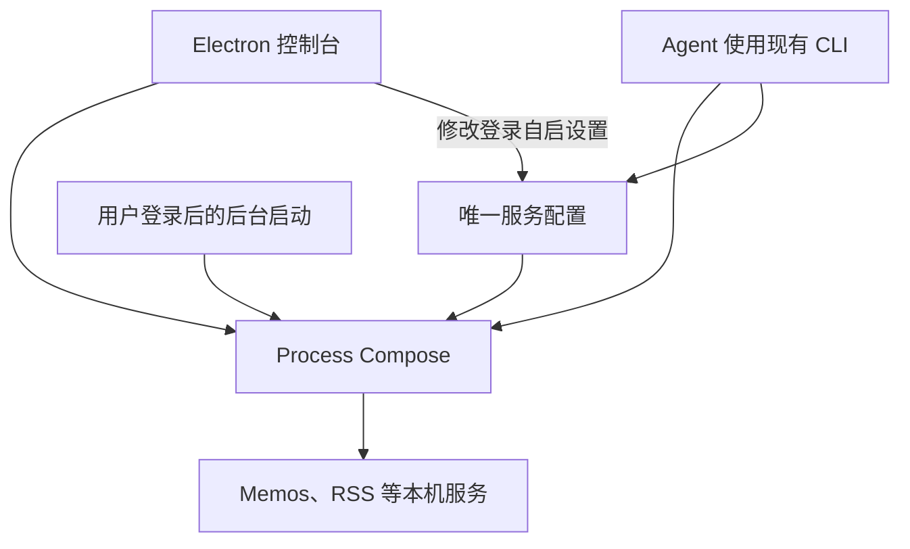

# LocalDeck MVP：本机服务控制台

Status: ready-for-agent

## Problem Statement

用户长期在 Mac 上运行 Memos、RSS 和本地后端等少量轻量服务，希望集中查看和操作，而不用记住启动命令、保留多个终端窗口或承担 Linux 虚拟机的常驻开销。

用户能够接受 Electron 控制台的合理内存开销。优先目标是方便管理、后台可靠运行和便于 Agent 操作；不追求极限压缩每一 MB 内存。

当前已有 Process Compose 的基础验证，但项目只有协作说明和领域词汇表，没有产品代码、测试框架或既有应用结构。

## Solution

提供一个供用户自己使用的 macOS 普通桌面窗口。控制台展示已登记服务的状态和资源占用，支持启动、停止、重启、打开网页、查看近期日志及设置登录自启。

服务直接作为本机进程运行。Process Compose 负责生命周期管理，Electron 提供控制台，macOS 的用户级后台启动机制负责在登录后拉起管理器。关闭窗口或退出控制台不停止服务。

新服务由 Agent 安装并登记。实现完成后提供一份简短接入说明，Agent 按说明修改唯一配置文件、应用修改并检查结果，无需专门插件或自研 CLI。

## User Stories

1. 作为用户，我希望在一个窗口里看到所有已登记服务，以便知道本机有哪些服务可用。
2. 作为用户，我希望看到每个服务当前的运行状态，以便区分运行中、已停止和运行失败。
3. 作为用户，我希望看到运行服务的 PID、CPU 和内存，以便了解当前资源占用。
4. 作为用户，我希望看到服务配置的访问地址，以便知道如何访问它。
5. 作为用户，我希望点击“打开”进入服务网页，以便不用记住端口或地址。
6. 作为用户，我希望点击“启动”运行已停止的服务，以便不用打开终端输入命令。
7. 作为用户，我希望点击“停止”停止服务，以便释放资源，并且不会被异常恢复立即重新拉起。
8. 作为用户，我希望点击“重启”重新运行服务，以便恢复日常的小故障。
9. 作为用户，我希望查看服务的近期日志，以便了解失败原因并交给 Agent 排查。
10. 作为用户，我希望分别设置每个服务的登录自启，以便只自动运行需要的服务。
11. 作为用户，我希望手动启停与登录自启设置互不影响，以便清楚地区分当前操作和下次登录的行为。
12. 作为用户，我希望退出控制台后服务继续运行，以便不必常驻管理窗口。
13. 作为用户，我希望重新打开控制台时看到真实状态，以便继续管理已有后台服务，而不重复启动它们。
14. 作为用户，我希望服务异常退出后自动尝试恢复，以便减少人工干预。
15. 作为用户，我希望连续失败后停止自动重试并显示原因，以便避免无限重启和反复刷日志。
16. 作为用户，我希望修复问题后能够手动重新启动服务，以便恢复使用，而不用重新登记。
17. 作为用户，我希望配置有误或后台不可连接时看到明确错误，以便不把未知状态误认为服务已停止。
18. 作为用户，我希望添加新服务时不影响其他正常服务，以便保持已有笔记和 RSS 的可用性。
19. 作为用户，我希望服务数据保存在持久目录，以便控制台退出、服务重启或配置变更不会删除笔记。
20. 作为 Agent，我希望通过一份接入说明找到配置和运行约定，以便在其他对话中独立完成登记。
21. 作为 Agent，我希望复用 Process Compose CLI 获取结构化状态并启停服务，以便无需操作图形界面。
22. 作为 Agent，我希望验证配置后应用修改并检查服务结果，以便确认登记成功，而不只确认文件已写入。
23. 作为用户，我希望控制台修改设置时保留 Agent 写入的其他配置，以便两种操作方式使用同一份可靠配置。
24. 作为用户，我希望没有登记服务时看到简单说明，以便知道下一步让 Agent 接入服务。

## Implementation Decisions

### 范围与职责

- 首版仅面向当前用户的 Mac。采用 Electron 和 Process Compose，不实现其他操作系统适配。
- Process Compose 是唯一服务生命周期管理器。控制台不直接维护另一套服务进程，也不自行实现通用进程监督器。
- 使用用户级 launchd 管理 Process Compose 后台生命周期。普通服务只由 Process Compose 管理，避免两个管理器同时监督同一个服务。
- 后台独立于控制台运行；所有服务停止后管理器仍应可连接。控制台启动不得生成重复管理器实例。
- 用户登录前运行、系统级后台服务和提权安装不属于本版。
- 不新建本地 Web 后端、数据库、插件系统或通用多后端抽象。界面状态直接来自现有管理器，持久设置来自配置。

### 配置与 Agent 登记

- 以一份人工可读配置为唯一服务配置来源，优先沿用 Process Compose YAML，不设计另一套完整编排语言。
- 每个服务具有稳定标识、显示名称、启动命令、工作目录、环境变量、配置的访问地址、日志位置、登录自启和重启策略。名称可默认沿用标识；无网页的服务不必有访问地址。
- LocalDeck 专用展示信息只增加必要字段。具体字段格式在验证 Process Compose 的扩展字段兼容性后确定，不维护第二份可独立编辑的同类配置。
- 配置及日志放在用户持久目录。服务程序和数据也使用持久位置，不以项目工作目录、临时目录或交互终端环境为运行前提。
- 服务登记与程序安装分开。LocalDeck 不下载程序、不安装 Python/Node 依赖、不自动接管已经运行的进程。
- Agent 使用现有配置校验、项目更新、状态和日志命令完成登记。应用修改前先校验；无效配置不得通过停止整个项目来处理。
- 更新新服务不得重启未修改的服务。修改已有服务的启动信息可能需要重启该服务，接入说明必须明确这一行为。
- 界面只编辑登录自启设置。写入前重新读取配置，保留其他字段，以原子替换避免半写文件；发现编辑期间发生外部修改时提示重试，不静默覆盖。
- 不要求自动监视配置文件。Agent 修改后显式应用配置，界面读取管理器返回的结果。

### 当前运行与登录自启

- 登录自启是持久设置，与服务当前状态分开。
- 登录自启开启的服务在下一次用户登录时启动；关闭的服务保持可见、可以手动启动。
- 当前服务运行时关闭登录自启，不立即停止该服务；当前服务停止时开启登录自启，不立即启动该服务。
- 手动停止开启登录自启的服务，本次保持停止，下次登录仍按设置启动。
- 不把“禁用且无法启动服务”的配置误当作“关闭登录自启”。实现前用真实管理器验证对应配置语义。
- 当前状态不另建持久化数据库，不恢复上一次退出控制台时的运行列表。

### 异常恢复

- 手动停止不触发自动恢复。异常退出后等待短暂间隔再重试，达到上限后停止并显示失败状态。
- 首版建议默认重试上限为 3 次、重试间隔为 2 秒；属于实现默认值，不新增界面配置项。
- 优先使用 Process Compose 现有 restart、backoff 和 max_restarts 能力。必须验证计数何时重置、手动启动能否开启新的尝试，以及正常退出与异常退出的区分。
- 已有文档不能证明“连续失败”具备按稳定运行时间自动重置的语义。首版不自研滑动窗口或额外重试调度器；界面和接入说明准确描述实际重试计数范围。
- 如果现有管理器不能满足有限恢复与手动恢复的核心行为，应记录具体差距再调整方案，不能悄悄改为无限重试。

### 控制台与本地连接

- 一个普通窗口展示服务列表和日志，不做菜单栏、托盘、通知中心或多窗口系统。
- 首版界面只使用英文，不引入多语言框架。
- 保持 Electron 技术选择，视觉风格接近 macOS 原生应用：系统字体、克制的颜色、清晰的分隔线、紧凑工具栏和标准窗口操作。参考用户提供的 OrbStack 截图的列表与详情关系，不逐像素模仿，不复制容器相关导航。
- 首版采用服务列表与所选服务详情的双栏结构，详情包含状态、资源、访问地址、自启设置及日志入口。服务数量少，不增加空洞的分类导航、图表或装饰性仪表盘。支持系统浅色和深色外观，不提供额外主题定制。
- 控制台展示运行中、已停止、启动或运行失败等易懂状态；无法连接后台时明确显示后台不可用，不把全部服务标为已停止。
- “进程运行中”只表示进程存在，不保证网页已经就绪。首版不增加统一健康检查系统。
- 展示配置的访问地址，并通过系统浏览器打开；不通过猜测端口生成地址。没有访问地址时不提供打开按钮。
- 优先复用 Process Compose 的资源指标。无法获取时显示不可用，不显示伪造的零值；明确内存统计是主进程还是进程树口径。
- 使用低频刷新或现有状态订阅，不为了实时曲线持续高频采样。窗口关闭后停止界面采样。
- 日志只读取近期有限内容，并提供刷新或有限实时追加。界面与后台日志保留都须有界，不能无限增长；优先采用现有日志机制。
- Electron 主进程负责本地连接与必要的配置写入，渲染界面通过有限操作接口访问；不向页面暴露任意 Shell 执行能力。
- 优先使用固定的用户私有 Unix socket 连接管理器，GUI 与 CLI 连接同一实例，不把管理接口暴露给局域网。

### 文档与交付

- 功能完成后编写短小的 Agent 接入说明，包含配置位置、最小例子、持久目录约定、校验与应用命令、结构化状态查询、日志排查、配置变更影响和移除登记注意事项。
- 当前阶段只写 spec，不提前编造尚不存在的命令和配置字段。
- 首版不新增自研 CLI。必要的启动集成保持最小，不发展成另一个命令框架。

## Testing Decisions

### 测试边界

- 以控制台和现有 CLI 触发的真实服务行为作为最高层测试边界：输入操作，检查 HTTP 可访问性、进程存在性、配置持久化和界面状态。
- 主要采用 Electron E2E 配合真实 Process Compose 和临时 HTTP 服务。不要通过模拟管理器返回值来证明生命周期正确。
- 只有配置写入、状态转换等难以通过 E2E 精确覆盖的错误路径需要少量单元测试，不逐个测试薄封装或内部调用次数。
- 项目没有现成测试框架。此前的独立临时验证只能作为证据与测试参考，不能代替本项目可重复运行的测试。

### 必须覆盖的验收场景

1. 从空配置启动，显示接入提示；登记临时服务后出现条目，CLI 和控制台看到同一状态。
2. 控制台启动服务后 HTTP 可访问；停止后不可访问且进程退出；重启后新实例可访问。
3. 退出控制台和启动它的终端后服务仍存活；再次打开控制台不生成重复实例。
4. GUI 与 CLI 交替启停同一服务，界面最终显示实际状态。
5. 模拟服务异常退出后自动恢复；持续失败达到重试上限后停止；修复并手动启动可以恢复。
6. 主动停止不会触发异常恢复，且不会改变登录自启设置。
7. 修改登录自启只改变下次登录行为，不改变服务当前状态。关闭自启的服务仍可手动启动。
8. 在真实用户登录流程中验证后台自动启动和逐服务自启设置，保留人工验收结果；不能用单纯重启 GUI 代替该项验证。
9. 新增一个服务后，原有未修改服务的 PID 和 HTTP 可用性保持不变。
10. 无效配置被拒绝时原有服务继续工作，并有可定位的错误；外部修改与 GUI 设置保存冲突时不丢字段。
11. 服务产生子进程时，停止后不留下继续提供服务的子进程。
12. 后台不可用、启动命令不存在、端口被占用时，显示准确错误和可用日志，而不伪装成成功。
13. 日志量增大时，近期日志仍可查看，界面读取量和后台保留量有界。
14. 没有资源数据或访问地址时，界面不展示误导数值或无效操作。

### 隔离与测量

- 测试使用独立临时配置、socket、随机本机端口和数据目录，结束后停止测试进程，不接管现有 Memos 或修改用户登录启动项。
- 登录自启验收需要受控设置真实启动项，记录并恢复测试前状态。
- 保留可查看的测试结果及失败日志。E2E 优先覆盖关键用户操作，不做像素级布局断言。
- 分别测量管理器、被管理服务、Electron 完整进程树在启动和空闲时的资源开销。控制台退出后确认其进程退出、后台服务仍在。
- 没有约定 Electron 的硬性内存上限；用户此前接受其他 Electron 应用约 150 MB 的占用，这不是本项目已验证的性能承诺。

## Out of Scope

- Linux 虚拟机、Docker 容器和容器管理。
- 重写进程管理器或同时支持多个管理后端。
- 应用商店、下载安装、一键部署、程序升级和运行时依赖安装。
- GUI 添加服务表单、完整 YAML 编辑器、依赖编排编辑器。
- 自研 CLI、Agent 插件或专用 Agent 协议。
- Windows/Linux 适配、分发签名、自动更新及面向其他用户的安装向导。
- 菜单栏、系统通知、远程管理、多用户、云同步和登录账户。
- 历史资源曲线、自动扫描本机所有服务、自动识别所有监听端口。
- 自研健康检查引擎、复杂依赖管理和重试调度器。
- 用户数据备份、迁移和删除；本 spec 不授权迁移当前临时 Memos、清理 Docker 容器或卸载 OrbStack。

## Further Notes

### 已验证的事实

- 本机通过官方 Homebrew tap 安装了 Process Compose v1.122.0。
- 管理一个临时 Python HTTP 服务、关闭 TUI 时，管理器三次短时 RSS 快照均为 50,608 KiB，约 49.4 MiB；CPU 快照为 0.0%。该数据不代表长期峰值。
- 独立临时测试验证了脱离启动 Shell 后可访问、CLI 启停和重启、手动停止保持停止、异常退出后重启，以及测试服务和管理器完整退出。
- CLI 的 JSON 状态包含 PID、CPU、内存、退出码和重启次数。
- 上述验证结束后测试后台已停止，没有改动现有 Memos，也没有设置登录自启。

### 文档依据与尚待验证的行为

- 官方客户端文档：https://f1bonacc1.github.io/process-compose/client
- 配置更新文档：https://f1bonacc1.github.io/process-compose/configuration
- 重启策略文档：https://f1bonacc1.github.io/process-compose/launcher
- 文档和本机 CLI 均提供 project update；文档提供 backoff_seconds 与 max_restarts。但配置更新的影响范围、自启字段的准确映射、重试计数重置和日志限制尚未在本项目验证。
- 实施首先用小型集成验证确定以上行为，然后固定配置格式。优先使用原生能力，不把未知行为当作已通过的验收，也不以新增通用框架解决它们。
- 当前 spec 已确定产品范围；技术验证如发现与核心验收冲突，应明确报告具体差距。仅影响内部实现的选择由实现者处理，无需让用户选择其不了解的底层技术。
