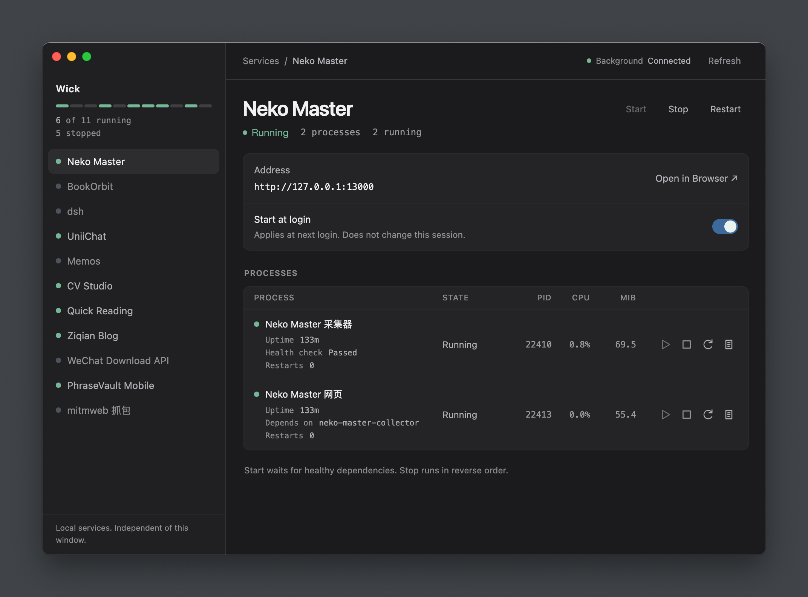
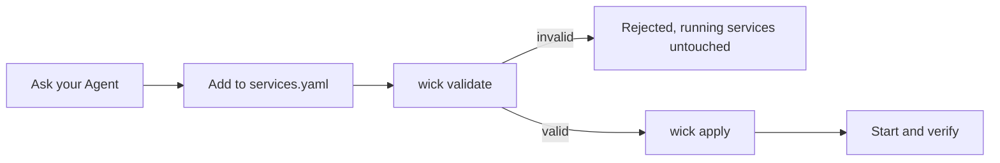

# Wick

A small macOS console for native local services. MyGo supplies the window using macOS's WKWebView; Process Compose runs the services. No bundled browser engine, Node runtime, Docker or Linux VM.

> The source is now the MyGo-based 0.2.0, requiring macOS 13+ on Apple Silicon. It has not been published yet; the Release installation below still refers to the published Electron-based 0.1.1. Build 0.2.0 with `npm run dmg` to obtain the smaller package.

**默认推荐：[从 Release 下载安装](https://github.com/RunMintOn/Wick/releases/latest)。** 下载 DMG，把 Wick 拖到 Applications 即可。无需下载源码，也无需安装 Node、npm、Homebrew 或 Process Compose。首次打开的 macOS 拦截处理见下文。



## Release 安装（默认推荐，供 Agent 执行）

> 用法：把这一节整段贴给 Agent，或者只给它仓库地址并说「按 README 装 Wick」。默认下载已发布的 DMG，不克隆源码、不在本机编译；只有用户明确要求源码开发或自行构建时，才使用后面的开发说明。

**Wick 是界面层，打包 App 已内置 Process Compose。** [Process Compose](https://github.com/f1bonacc1/process-compose) 是独立的开源本机进程编排器。普通安装无需再通过 Homebrew 安装它，也不需要 Node、npm 或源码目录。

| 谁 | 干什么 |
|---|---|
| Process Compose | 真正启停、守护本机进程，持有控制 socket |
| macOS launchd | 登录时拉起后台 |
| Wick | 通过 socket 读状态、发操作，提供窗口和 CLI |

### 第 1 步：安装到固定位置

先确认是 macOS 12 或更新版本、Apple Silicon（`uname -m` 输出 `arm64`），检查 `/Applications/Wick.app` 是否已经安装；已安装时复用，不擅自覆盖或升级。若已有旧版缺少下文的包内 CLI，先与用户确认升级，不静默覆盖。

从 [GitHub Release](https://github.com/RunMintOn/Wick/releases/tag/v0.1.1) 下载 `Wick-0.1.1-darwin-arm64.dmg` 和对应的 `.sha256` 文件，校验后安装。**普通安装不需要构建工具，也不需要另装 Process Compose。** 可以在可写目录中执行：

```bash
curl -fL -o Wick-0.1.1-darwin-arm64.dmg \
  https://github.com/RunMintOn/Wick/releases/download/v0.1.1/Wick-0.1.1-darwin-arm64.dmg
curl -fL -o Wick-0.1.1-darwin-arm64.dmg.sha256 \
  https://github.com/RunMintOn/Wick/releases/download/v0.1.1/Wick-0.1.1-darwin-arm64.dmg.sha256
shasum -a 256 -c Wick-0.1.1-darwin-arm64.dmg.sha256
```

校验失败就停止。打开 DMG，把 Wick 拖到 Applications；Agent 也可以用下面的命令。确认目标不存在后，复制**整个 App** 到默认位置，不从磁盘镜像直接运行：

```bash
MOUNT_DIR="$(mktemp -d)"
hdiutil attach Wick-0.1.1-darwin-arm64.dmg -readonly -nobrowse -noautoopen -mountpoint "$MOUNT_DIR"
ditto "$MOUNT_DIR/Wick.app" /Applications/Wick.app
hdiutil detach "$MOUNT_DIR"
```

App 未签名、未公证。下载的 App 被 macOS 隔离标记拦截时，确认来源后执行：

```bash
xattr -dr com.apple.quarantine /Applications/Wick.app
```

**必须从固定位置运行。** 默认使用 `/Applications/Wick.app`；无权限时可与用户约定 `~/Applications/Wick.app`，后续路径一并替换。不要从 Downloads 或挂载的磁盘镜像运行：后台登录任务记录 App 的绝对路径。安装后的 Skill、CLI、Process Compose 都在 App 内，不依赖构建时的源码目录。

### 第 2 步：读取 App 内的 Agent 操作说明

将 `APP` 设为实际安装位置，直接读取 `$APP/Contents/Resources/app/skills/wick/SKILL.md`，无需先安装 Skill 或保留源码：

```bash
APP=/Applications/Wick.app
SKILL_DIR="$APP/Contents/Resources/app/skills/wick"
WICK="$APP/Contents/Resources/app/bin/wick"
/bin/sh "$WICK" --help
```

App 提供内置 CLI，不要求系统安装 Node 或 npm。

### 第 3 步：询问是否创建可选 Skill 软链接

**默认不创建，必须询问用户；用户同意后才执行：**

```bash
/bin/sh "$WICK" skill:install
```

默认的全局位置是当前用户的 `~/.agents/skills/wick`，指向 `$APP/Contents/Resources/app/skills/wick`。这不是所有用户共用的系统目录。目标已有无关目录或指向别处的软链接时，安装器保留原内容并报错；先询问如何处理，不自动覆盖。选择不创建也不影响当前 Agent 直接读取说明、使用 CLI。

本 Skill 设置了 **`disable-model-invocation: true`**。支持此字段的 Agent 不应自动调用它，需用户显式调用；具体是否向模型展示名称或描述，取决于 Agent 的实现。软链接不等于自动加载或调用，也不阻止按用户要求直接读取文件。不支持该字段的 Agent 以自身行为为准。

### 第 4 步：打开控制台，登记并验证服务

```bash
open "$APP"
/bin/sh "$WICK" list
```

首次正常启动会创建配置和用户级登录后台任务。默认服务列表为空，**不会导入或停止已有进程**。

按已读取的 Skill 查明用户目标服务的启动方式、端口、数据路径及已有实例，再修改唯一配置 `~/Library/Application Support/Wick/services.yaml`。先校验，再应用，然后启动并验证：

```bash
/bin/sh "$WICK" validate
/bin/sh "$WICK" apply
/bin/sh "$WICK" start <service-id>
/bin/sh "$WICK" list
```

完成条件：实际服务入口可访问，配置和日志正常，未修改的服务未被重启；说明登录自启设置。关闭窗口只退出控制台，服务继续运行。

## Daily use

- Select a service to see status, PID, CPU, main-process RSS, address and exit details.
- Use **Start**, **Stop**, **Restart** or **Show logs**. **Open in Browser ↗** is next to the service Address.
- A service can contain multiple processes. Its detail shows each process, dependency, readiness and logs. Start waits for healthy dependencies; partial failures keep already-running processes and can be retried. Stop runs in reverse dependency order. One login switch controls the whole service.
- **Health check** appears only for a running process with a configured check: Passed, Failed or Checking. This applies to single-process services too. Without a check, Running means the process is active, not that its web page is ready. Stopped processes do not show live resource readings.
- The top indicator reports the background connection: Connected, Connecting or Unavailable. Configuration errors do not mean the background is disconnected. Use **Reconnect** when unavailable.
- **Start at login** affects the next background startup, not the current service state.
- Closing the window quits the console. Services continue running.
- **Refresh** rereads status; when the background is unavailable this button becomes **Reconnect**, which tries to reconnect/start it if needed.

Ask your Agent to read the [Wick Skill](skills/wick/SKILL.md) and register an installed service. You do not need to remember startup commands. The one editable file is `~/Library/Application Support/Wick/services.yaml`. Generated runtime files are not configuration sources.

## Agent Skill

The Chinese [Wick Skill](skills/wick/SKILL.md) covers service registration, configuration and commands, existing-process takeover and data handling, daily operations, login autostart, recovery and troubleshooting.

For packaged Agent operations, use `/bin/sh "$WICK" list` or `start|stop|restart <service> [process]`, with `WICK` set as above. The CLI and console share the same management interface; CLI queries return JSON. Component stop/restart requires impact confirmation when dependents are active (`--confirm-impact` after confirmation). Stderr alone does not mean failure. Existing-process takeover records the old login policy and asks whether to retain it, disables the old manager registration without deleting its recovery configuration, and verifies data and unrelated service PIDs.

```bash
/bin/sh "$WICK" skill:install
```

Only run this after asking the user. It links the installed App's Skill into `~/.agents/skills/wick`, preserving an existing unrelated entry. Keep the App at its installed location. Agents supporting the shared skills directory can discover it; reload their skills or start a new session as needed. Invocation depends on support for `disable-model-invocation: true`, as described above.

### Registering a service



`services.yaml` is the only configuration source; `runtime.yaml` is generated. Always validate before applying, and never run `process-compose project update -f services.yaml` directly.

## 源码开发与验证（仅开发者）

This section is for developers modifying Wick or users explicitly choosing to build it themselves. It is not the normal installation path; use the Release instructions above to install Wick.

Source development requires Go 1.27.3+; Node 22+ (or Bun's Node-compatible runner) runs the build scripts and E2E tests. There are no npm package dependencies. Installed users need none of these tools.

The default source Process Compose is `/opt/homebrew/bin/process-compose`; set `WICK_PC` to override it. Building bundles the pinned 1.122.0 binary automatically, so no Homebrew installation is needed to build or run the App.

Clone `https://github.com/RunMintOn/Wick.git`, then:

```bash
npm run dmg
npm run check
npm test
npm run test:e2e
```

The App is `build/Wick-darwin-arm64/Wick.app`. The DMG and its `.sha256` sidecar are in `build/`. The pre-migration `dist/` output is no longer produced. `npm run build` builds just the App; `npm start` runs the Go source and needs an external Process Compose (or `WICK_PC` pointing at the built App's binary).

The frontend is embedded directly into the Go executable; no frontend bundler or development server is required. `src/bridge.js` maps the existing UI operations to MyGo's Go bindings. The CLI and console share `internal/wick`.

The application icon source is the transparent 1024×1024 PNG in `assets/icon.png`. Each build uses macOS `sips` and `iconutil` to generate all required sizes and package `assets/icon.icns`. To update the artwork, replace the PNG and rebuild.

The build produces a local unsigned/unnotarized Apple Silicon App. It replaces its generated App in `build/`, not a daily installation elsewhere. `WICK_BUILD_OUT` overrides the output directory; do not point it at a daily installation. The build verifies the pinned Process Compose archive and includes its upstream license plus the licenses of the linked Go modules.

`npm run dmg` builds the App and creates `Wick-<version>-darwin-arm64.dmg` plus its `.sha256` sidecar in the same output directory. The DMG contains the App and an Applications shortcut. It uses macOS `hdiutil`, with no extra packaging dependency.

Source developers can run `/bin/sh bin/wick --help` or use the existing npm scripts. `npm run skill:install` links the source Skill instead of the App's copy; this is optional and requires keeping the source directory fixed. Do not run either Skill installer without asking the user.

`go test ./...` exercises real Process Compose in isolated data directories: lifecycle, configuration apply, autostart, component dependencies, recovery and a separately labelled launchd job. Build the App first. Tests use the bundled Process Compose by default; `WICK_PC` overrides it.

`npm run test:e2e` tests the DMG mount/copy/unmount flow and the installed CLI with Node/Homebrew absent from PATH, including a real HTTP service and optional Skill linking inside a temporary home. It also tests the actual hidden WKWebView using MyGo's automation plugin in an E2E-only binary, including rendering, service start, logs, autostart and service survival after closing the window. The release binary excludes this automation plugin.

Results and a screenshot are retained in `.scratch/mygo-migration/evidence/`. `WICK_TEST_BUNDLE` and `WICK_TEST_DMG` override the tested artifacts. `WICK_BUILD_OUT` is also honored by the E2E runner.

Set `WICK_HOME` to an absolute temporary directory for isolated use; this prevents the GUI from installing the normal login job. `WICK_HEADLESS=1` hides the window and prevents application activation. Tests use these settings automatically and do not operate the user's desktop. Run tests after building, not concurrently with a build replacing their binaries.

## Background and troubleshooting

- User job: `dev.wick.manager`, defined under your user LaunchAgents directory.
- Private control socket: `control.sock` in the Wick data directory.
- Recent logs: last 200 lines, capped at 128 KiB in the console.
- Service log files: native rotation, by default 1 MiB plus 2 backups.
- Bootstrap diagnostics: `startup.log`, replaced on background startup.
- Default crash recovery: 3 automatic retries, 2-second backoff. The count accumulates for that service's current registration; it is not a sliding time-window counter. After exhaustion, fix the cause and use the console's Start or `/bin/sh "$WICK" recover <service>`.
- Process Compose does not reliably identify whether signal exit `-1` was a manual stop. The console shows the exit code and an explanation rather than inventing the cause.
- If an operation was interrupted and left `operation.lock`, check that no Wick configuration/start operation is running, then move that generated lock to Trash and retry.
- Applying invalid configuration does not stop existing services. Fix the configuration, apply it again, then Refresh.

Disabling every service's login switch leaves the lightweight manager available but starts no service. To stop the background manager for the current session, quit the console and use Process Compose's `down` command with the Wick socket. To disable the login background entirely, unload `dev.wick.manager` and move its plist to Trash; opening the app normally installs it again.

## Package size

The MyGo migration removes Electron and reuses the system WKWebView. The UI, CLI and configuration logic are compiled into one Go executable; Process Compose remains bundled.

| Artifact | Approximate size |
|---|---|
| Published 0.1.1 DMG (Electron) | 158 MB |
| Local 0.2.0 DMG (MyGo) | 23.4 MB |
| Local 0.2.0 App, expanded | 56.3 MB |

These are disk/download sizes, not RAM measurements. Exact bytes and verification results are recorded in [.scratch/mygo-migration/validation.md](.scratch/mygo-migration/validation.md).

## License

MIT，见 [LICENSE](LICENSE)。

Wick 自身以 MIT 发布。打包 App 内置的 [Process Compose](https://github.com/f1bonacc1/process-compose) 是独立项目，采用 Apache-2.0。其许可证随 App 放在 `Contents/Resources/licenses/process-compose/`，来源与版本见 [THIRD-PARTY-NOTICES.md](THIRD-PARTY-NOTICES.md)。

## Validation limits

Real launchd bootstrap and supervision were exercised in the existing login session using the Go executable. **Actual logout/re-login has not been tested**, because it would interrupt the user's session. macOS 13+ is the deployment target: MyGo requires Go 1.27, which dropped macOS 12 support. Verification ran on macOS 15.7.9 arm64, not every supported OS version. The App remains unsigned/unnotarized. The author's own installation was replaced with this build afterwards; that swap is recorded in `.scratch/mygo-migration/validation.md`.

Resource observations, screenshots and test results are recorded under `.scratch`.
