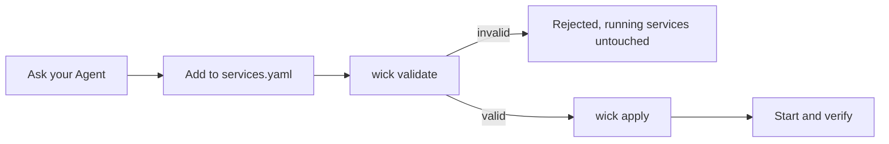

# Wick

A small macOS console for native local services. Electron supplies the window; Process Compose runs the services. No Docker or Linux VM.

**默认推荐：[从 Release 下载安装](https://github.com/RunMintOn/Wick/releases/latest)。** 下载 DMG，把 Wick 拖到 Applications 即可。无需下载源码，也无需安装 Node、npm、Homebrew 或 Process Compose。首次打开的 macOS 拦截处理见下文。


## Release 安装（默认推荐，供 Agent 执行）

> 用法：把这一节整段贴给 Agent，或者只给它仓库地址并说「按 README 装 Wick」。默认下载已发布的 DMG，不克隆源码、不在本机编译；只有用户明确要求源码开发或自行构建时，才使用后面的开发说明。

**Wick 是界面层，打包 App 已内置 Process Compose。** [Process Compose](https://github.com/f1bonacc1/process-compose) 是独立的开源本机进程编排器。普通安装无需再通过 Homebrew 安装它，也不需要 Node、npm 或源码目录。

| 谁 | 干什么 |
|---|---|
| Process Compose | 真正启停、守护本机进程，持有控制 socket |
| macOS launchd | 登录时拉起后台 |
| Wick | 通过 socket 读状态、发操作，提供窗口和 CLI |

### 第 1 步：安装到固定位置

先确认是 macOS 12 或更新版本、Apple Silicon（`uname -m` 输出 `arm64`），检查 `/Applications/Wick.app` 是否已经安装；已安装时复用，不擅自覆盖或升级。若已有旧版缺少下文的包内 CLI，先与用户确认升级，不静默覆盖。

从 [GitHub Release](https://github.com/RunMintOn/Wick/releases/tag/v0.1.1) 下载 `Wick-0.1.1-darwin-arm64.dmg` 和对应的 `.sha256` 文件，校验后安装。**普通安装不需要构建工具，也不需要另装 Process Compose。** 可以在可写目录中执行：

```bash
curl -fL -o Wick-0.1.1-darwin-arm64.dmg \
  https://github.com/RunMintOn/Wick/releases/download/v0.1.1/Wick-0.1.1-darwin-arm64.dmg
curl -fL -o Wick-0.1.1-darwin-arm64.dmg.sha256 \
  https://github.com/RunMintOn/Wick/releases/download/v0.1.1/Wick-0.1.1-darwin-arm64.dmg.sha256
shasum -a 256 -c Wick-0.1.1-darwin-arm64.dmg.sha256
```

校验失败就停止。打开 DMG，把 Wick 拖到 Applications；Agent 也可以用下面的命令。确认目标不存在后，复制**整个 App** 到默认位置，不从磁盘镜像直接运行：

```bash
MOUNT_DIR="$(mktemp -d)"
hdiutil attach Wick-0.1.1-darwin-arm64.dmg -readonly -nobrowse -noautoopen -mountpoint "$MOUNT_DIR"
ditto "$MOUNT_DIR/Wick.app" /Applications/Wick.app
hdiutil detach "$MOUNT_DIR"
```

App 未签名、未公证。下载的 App 被 macOS 隔离标记拦截时，确认来源后执行：

```bash
xattr -dr com.apple.quarantine /Applications/Wick.app
```

**必须从固定位置运行。** 默认使用 `/Applications/Wick.app`；无权限时可与用户约定 `~/Applications/Wick.app`，后续路径一并替换。不要从 Downloads 或挂载的磁盘镜像运行：后台登录任务记录 App 的绝对路径。安装后的 Skill、CLI、Process Compose 都在 App 内，不依赖构建时的源码目录。

### 第 2 步：读取 App 内的 Agent 操作说明

将 `APP` 设为实际安装位置，直接读取 `$APP/Contents/Resources/app/skills/wick/SKILL.md`，无需先安装 Skill 或保留源码：

```bash
APP=/Applications/Wick.app
SKILL_DIR="$APP/Contents/Resources/app/skills/wick"
WICK="$APP/Contents/Resources/app/bin/wick"
/bin/sh "$WICK" --help
```

App 提供的 CLI 使用包内 Electron 运行，不要求系统安装 Node 或 npm。

### 第 3 步：询问是否创建可选 Skill 软链接

**默认不创建，必须询问用户；用户同意后才执行：**

```bash
/bin/sh "$WICK" skill:install
```

默认的全局位置是当前用户的 `~/.agents/skills/wick`，指向 `$APP/Contents/Resources/app/skills/wick`。这不是所有用户共用的系统目录。目标已有无关目录或指向别处的软链接时，安装器保留原内容并报错；先询问如何处理，不自动覆盖。选择不创建也不影响当前 Agent 直接读取说明、使用 CLI。

本 Skill 设置了 **`disable-model-invocation: true`**。支持此字段的 Agent 不应自动调用它，需用户显式调用；具体是否向模型展示名称或描述，取决于 Agent 的实现。软链接不等于自动加载或调用，也不阻止按用户要求直接读取文件。不支持该字段的 Agent 以自身行为为准。

### 第 4 步：打开控制台，登记并验证服务

```bash
open "$APP"
/bin/sh "$WICK" list
```

首次正常启动会创建配置和用户级登录后台任务。默认服务列表为空，**不会导入或停止已有进程**。

按已读取的 Skill 查明用户目标服务的启动方式、端口、数据路径及已有实例，再修改唯一配置 `~/Library/Application Support/Wick/services.yaml`。先校验，再应用，然后启动并验证：

```bash
/bin/sh "$WICK" validate
/bin/sh "$WICK" apply
/bin/sh "$WICK" start <service-id>
/bin/sh "$WICK" list
```

完成条件：实际服务入口可访问，配置和日志正常，未修改的服务未被重启；说明登录自启设置。关闭窗口只退出控制台，服务继续运行。

## Daily use

- Select a service to see status, PID, CPU, main-process RSS, address and exit details.
- Use **Start**, **Stop**, **Restart** or **Show logs**. **Open in Browser ↗** is next to the service Address.
- A service can contain multiple processes. Its detail shows each process, dependency, readiness and logs. Start waits for healthy dependencies; partial failures keep already-running processes and can be retried. Stop runs in reverse dependency order. One login switch controls the whole service.
- **Health check** appears only for a running process with a configured check: Passed, Failed or Checking. This applies to single-process services too. Without a check, Running means the process is active, not that its web page is ready. Stopped processes do not show live resource readings.
- The top indicator reports the background connection: Connected, Connecting or Unavailable. Configuration errors do not mean the background is disconnected. Use **Reconnect** when unavailable.
- **Start at login** affects the next background startup, not the current service state.
- Closing the window quits the console. Services continue running.
- **Refresh** rereads status; when the background is unavailable this button becomes **Reconnect**, which tries to reconnect/start it if needed.

Ask your Agent to read the [Wick Skill](skills/wick/SKILL.md) and register an installed service. You do not need to remember startup commands. The one editable file is `~/Library/Application Support/Wick/services.yaml`. Generated runtime files are not configuration sources.

## Agent Skill

The Chinese [Wick Skill](skills/wick/SKILL.md) covers service registration, configuration and commands, existing-process takeover and data handling, daily operations, login autostart, recovery and troubleshooting.

For packaged Agent operations, use `/bin/sh "$WICK" list` or `start|stop|restart <service> [process]`, with `WICK` set as above. The CLI and console share the same management interface; CLI queries return JSON. Component stop/restart requires impact confirmation when dependents are active (`--confirm-impact` after confirmation). Stderr alone does not mean failure. Existing-process takeover records the old login policy and asks whether to retain it, disables the old manager registration without deleting its recovery configuration, and verifies data and unrelated service PIDs.

```bash
/bin/sh "$WICK" skill:install
```

Only run this after asking the user. It links the installed App's Skill into `~/.agents/skills/wick`, preserving an existing unrelated entry. Keep the App at its installed location. Agents supporting the shared skills directory can discover it; reload their skills or start a new session as needed. Invocation depends on support for `disable-model-invocation: true`, as described above.

### Registering a service



`services.yaml` is the only configuration source; `runtime.yaml` is generated. Always validate before applying, and never run `process-compose project update -f services.yaml` directly.

## 源码开发与验证（仅开发者）

This section is for developers modifying Wick or users explicitly choosing to build it themselves. It is not the normal installation path; use the Release instructions above to install Wick.

Direct source development still requires Node 22.12+ and a separately installed Process Compose (`brew install f1bonacc1/tap/process-compose`). The default source binary is `/opt/homebrew/bin/process-compose`; `WICK_PC` can override it in both source and packaged runs. Packaged runs default to their own pinned 1.122.0 binary.

To build the App yourself, clone `https://github.com/RunMintOn/Wick.git`, run `npm install` and `npm run build`, then copy `dist/Wick-darwin-arm64/Wick.app` to the fixed installation location. Building does not require a separate Process Compose installation; the first build downloads Electron and the pinned Process Compose archive.

```bash
npm install
npm start
npm run check
npm test
npm run test:e2e
npm run build
npm run measure
```

The optional measurement command requires the macOS Command Line Tools and a completed build. It launches only isolated test services, captures the complete Electron process tree and macOS physical-footprint counters, saves screenshots/results, then stops the test processes.

The application icon source is the transparent 1024×1024 PNG in `assets/icon.png`. Each build uses macOS `sips` and `iconutil` to generate all required sizes and package `assets/icon.icns`. To update the artwork, replace the PNG and rebuild.

The build produces a local unsigned Apple Silicon app. It is not a signed public release. `npm run build` replaces its own generated output only. Set `WICK_BUILD_OUT` to an absolute temporary directory to avoid replacing an App you use daily. The build verifies the official Process Compose archive's pinned SHA-256 and includes its upstream license. Downloaded archives are cached under `.cache/` and reverified on every build.

`npm run dmg` builds the App and creates `Wick-<version>-darwin-arm64.dmg` plus its `.sha256` sidecar in the same output directory. The DMG contains the App and an Applications shortcut. It uses macOS `hdiutil`, with no extra packaging dependency.

Source developers can run `/bin/sh bin/wick --help` or use the existing npm scripts. `npm run skill:install` links the source Skill instead of the App's copy; this is optional and requires keeping the source directory fixed. Do not run either Skill installer without asking the user.

Packaged onboarding is tested with `WICK_TEST_BUNDLE=/absolute/path/to/Wick.app node --test tests/packaged-agent.test.cjs`. It uses a temporary home, a hidden window and a PATH without Node/Homebrew; results are written to `.scratch/bundled-process-compose/evidence/packaged-agent.json`.

Set `WICK_TEST_DMG=/absolute/path/to/Wick-<version>-darwin-arm64.dmg` when running `tests/dmg.test.cjs` to verify the checksum, mount/copy/unmount flow, and Agent operations from the installed copy. It does not install into your real Applications directory.

Set `WICK_HOME` to an absolute temporary directory for isolated testing. This also prevents the GUI from installing the normal login job. Integration tests use real Process Compose; login tests use distinct launchd labels and remove those jobs afterward. Run tests sequentially.

Use `WICK_HEADLESS=1 npm run test:e2e` to keep Electron test windows hidden.

## Background and troubleshooting

- User job: `dev.wick.manager`, defined under your user LaunchAgents directory.
- Private control socket: `control.sock` in the Wick data directory.
- Recent logs: last 200 lines, capped at 128 KiB in the console.
- Service log files: native rotation, by default 1 MiB plus 2 backups.
- Bootstrap diagnostics: `startup.log`, replaced on background startup.
- Default crash recovery: 3 automatic retries, 2-second backoff. The count accumulates for that service's current registration; it is not a sliding time-window counter. After exhaustion, fix the cause and use the console's Start or `/bin/sh "$WICK" recover <service>`.
- Process Compose does not reliably identify whether signal exit `-1` was a manual stop. The console shows the exit code and an explanation rather than inventing the cause.
- If an operation was interrupted and left `operation.lock`, check that no Wick configuration/start operation is running, then move that generated lock to Trash and retry.
- Applying invalid configuration does not stop existing services. Fix the configuration, apply it again, then Refresh.

Disabling every service's login switch leaves the lightweight manager available but starts no service. To stop the background manager for the current session, quit the console and use Process Compose's `down` command with the Wick socket. To disable the login background entirely, unload `dev.wick.manager` and move its plist to Trash; opening the app normally installs it again.

## Memory observations

On 2026-10-28, local Apple Silicon measurements of the packaged App showed:

| State | Observed physical footprint |
|---|---|
| Console open, hidden test window (3 samples) | 120–138 MiB across 4 Electron processes |
| Console open, earlier visible-window observation | About 156 MiB |
| Console closed | No console processes remained |
| Existing Process Compose background, console closed | About 27.8 MiB |

Closing the test window left the test service reachable with the same PID. Managed services consume their own memory, which is not included above.

These are observations from before the bundled-dependency changes, not a fresh measurement of the latest build or a memory limit. Hidden and visible windows are different test conditions. Values use macOS `phys_footprint`; process sums are not exact unique physical RAM. RSS sums also include shared mappings. See `npm run measure` above for the isolated measurement workflow.

## License

MIT，见 [LICENSE](LICENSE)。

Wick 自身以 MIT 发布。打包 App 内置的 [Process Compose](https://github.com/f1bonacc1/process-compose) 是独立项目，采用 Apache-2.0。其许可证随 App 放在 `Contents/Resources/licenses/process-compose/`，来源与版本见 [THIRD-PARTY-NOTICES.md](THIRD-PARTY-NOTICES.md)。

## Validation limits

Real launchd bootstrap and supervision were exercised in the existing login session, including the packaged app's Node bootstrap. **Actual logout/re-login has not been tested**, because it would interrupt the user's session. No Memos data migration or OrbStack/Docker cleanup was performed.

Resource observations, screenshots and test results are recorded under `.scratch`.
