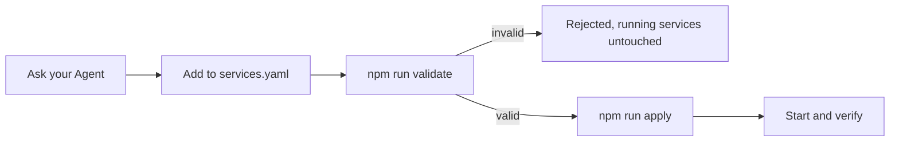

# Wick

A small macOS console for native local services. Electron supplies the window; Process Compose runs the services. No Docker or Linux VM.


## 给 Agent 的安装说明

> 用法：把这一节整段贴给 Agent，或者只给它仓库地址并说「按 README 装 Wick」。

**Wick 是界面层，不是服务管理器。** 它自己不启动、不守护、不重启任何进程。干活的是另一个开源项目 [Process Compose](https://github.com/f1bonacc1/process-compose)（Go 写的本机进程编排器，作用类似本地版 Docker Compose）。三者的分工：

| 谁 | 干什么 |
|---|---|
| Process Compose | 真正启停、守护本机进程，持有控制 socket |
| macOS launchd | 登录时拉起后台 |
| Wick | 通过 socket 读状态、发操作，画成窗口和 CLI |

所以只有一句结论：**没有 Process Compose，Wick 什么都做不了，安装顺序不能反。**

### 第 1 步：确认环境

```bash
uname -m     # 必须是 arm64
node -v      # 需要 22 及以上
brew --version
```

不是 arm64 就停下来告诉用户：目前只提供 Apple Silicon 版本。

### 第 2 步：装 Process Compose

```bash
brew install f1bonacc1/tap/process-compose
process-compose version
```

装完确认能执行。默认找 `/opt/homebrew/bin/process-compose`；如果它在别处，之后每一步都要先 `export WICK_PC=<实际路径>`，否则 Wick 只会报找不到。

Wick 在 Process Compose `1.122.0` 上验证过。版本差很多时先跟用户确认。

### 第 3 步：取 Wick 源码

Agent 要用的 Skill 和 CLI 都在源码里。只装一个 `.app` 的话，Agent 无法读取或修改配置。

```bash
git clone https://github.com/RunMintOn/Wick.git
cd Wick
npm install
npm run build
```

产出 `dist/Wick-darwin-arm64/Wick.app`，未签名。首次安装会下载 Electron，需要几分钟。

### 第 4 步：装 Skill

**装 Wick 不会自动装 Skill。** 构建、打开控制台、首次启动都不碰 `~/.agents/skills`。没有这一步，Agent 读不到操作说明，也用不了 CLI。

Skill 随源码保存，只有一个文件：

| 位置 | 作用 |
|---|---|
| `skills/wick/SKILL.md` | 仓库里的源文件，Agent 实际操作说明 |
| `~/.agents/skills/wick` | 安装后的软链，指向上面的目录；Agent 从这里发现 |

```bash
npm run skill:install
```

装完后在新会话里用 `/skill:wick`，或由支持共享 `~/.agents/skills` 目录的 Agent 自动发现。

两个注意点：

- 目标位置已有同名但指向别处的 Skill 时，脚本会报错退出，不会覆盖你的东西。
- **源码目录不能删也不能挪**：软链指回来，移动后 Agent 的 CLI 全部失效。

### 第 5 步：登记服务

Wick 默认配置里没有任何服务，第一次打开是空列表，这是正常状态，不是出错。把你的服务交给 Agent：

> 读 `skills/wick/SKILL.md`，把 `/path/to/your-service` 登记进 Wick，端口 8080。

只有 Agent 知道你的服务怎么启动、数据在哪、有没有已在跑的进程需要接管。唯一配置是 `~/Library/Application Support/Wick/services.yaml`。

### 第 6 步：打开控制台

```bash
open dist/Wick-darwin-arm64/Wick.app
```

也可以先复制到 `Applications` 再打开。**必须从固定位置打开，不要从 Downloads 直接运行**：后台登录任务的启动命令记录的是 App 的绝对路径，之后再移动就会失效。

首次正常启动会创建服务配置和用户级登录后台任务。默认配置没有服务，**不会导入或停止任何已有进程**；登录自启只启动各自开关已打开的服务。

以后从 Releases 下载 dmg 时，拖进 Applications 后要去掉隔离标记，否则未签名应用会被 macOS 拦住：

```bash
xattr -dr com.apple.quarantine /Applications/Wick.app
```

`-r` 必须加，否则包内文件仍会被拦。

## Daily use

- Select a service to see status, PID, CPU, main-process RSS, address and exit details.
- Use **Start**, **Stop**, **Restart** or **Show logs**. **Open in Browser ↗** is next to the service Address.
- A service can contain multiple processes. Its detail shows each process, dependency, readiness and logs. Start waits for healthy dependencies; partial failures keep already-running processes and can be retried. Stop runs in reverse dependency order. One login switch controls the whole service.
- **Health check** appears only for a running process with a configured check: Passed, Failed or Checking. This applies to single-process services too. Without a check, Running means the process is active, not that its web page is ready. Stopped processes do not show live resource readings.
- The top indicator reports the background connection: Connected, Connecting or Unavailable. Configuration errors do not mean the background is disconnected. Use **Reconnect** when unavailable.
- **Start at login** affects the next background startup, not the current service state.
- Closing the window quits the console. Services continue running.
- **Refresh** rereads status; when the background is unavailable this button becomes **Reconnect**, which tries to reconnect/start it if needed.

Ask your Agent to read the [Wick Skill](skills/wick/SKILL.md) and register an installed service. You do not need to remember startup commands. The one editable file is `~/Library/Application Support/Wick/services.yaml`. Generated runtime files are not configuration sources.

## Agent Skill

The Chinese [Wick Skill](skills/wick/SKILL.md) covers service registration, configuration and commands, existing-process takeover and data handling, daily operations, login autostart, recovery and troubleshooting.

For Agent operations, use `npm run --silent service -- list` or `start|stop|restart <service> [process]`. The CLI and console share the same management interface; CLI queries return JSON. Component stop/restart requires impact confirmation when dependents are active (`--confirm-impact` after confirmation). Stderr alone does not mean failure. Existing-process takeover records the old login policy and asks whether to retain it, disables the old manager registration without deleting its recovery configuration, and verifies data and unrelated service PIDs.

```bash
npm run skill:install
```

This links the repository's Skill into `~/.agents/skills/wick`, preserving an existing unrelated Skill. Keep the repository at its installed location. Pi discovers this shared directory; run `/reload` in an existing session or start a new session, then use `/skill:wick` when an explicit invocation is useful. Other Agents that support the shared Agent Skills directory can discover it too.

### Registering a service



`services.yaml` is the only configuration source; `runtime.yaml` is generated. Always validate before applying, and never run `process-compose project update -f services.yaml` directly.

## Develop and verify

```bash
npm install
npm start
npm run check
npm test
npm run test:e2e
npm run build
npm run measure
```

The optional measurement command requires the macOS Command Line Tools and a completed build. It launches only isolated test services, captures the complete Electron process tree and macOS physical-footprint counters, saves screenshots/results, then stops the test processes.

The application icon source is the transparent 1024×1024 PNG in `assets/icon.png`. Each build uses macOS `sips` and `iconutil` to generate all required sizes and package `assets/icon.icns`. To update the artwork, replace the PNG and rebuild.

The build produces a local unsigned Apple Silicon app. It is not a signed public release. `npm run build` replaces its own generated output only.

Set `WICK_HOME` to an absolute temporary directory for isolated testing. This also prevents the GUI from installing the normal login job. Integration tests use real Process Compose; login tests use distinct launchd labels and remove those jobs afterward. Run tests sequentially.

Use `WICK_HEADLESS=1 npm run test:e2e` to keep Electron test windows hidden.

## Background and troubleshooting

- User job: `dev.wick.manager`, defined under your user LaunchAgents directory.
- Private control socket: `control.sock` in the Wick data directory.
- Recent logs: last 200 lines, capped at 128 KiB in the console.
- Service log files: native rotation, by default 1 MiB plus 2 backups.
- Bootstrap diagnostics: `startup.log`, replaced on background startup.
- Default crash recovery: 3 automatic retries, 2-second backoff. The count accumulates for that service's current registration; it is not a sliding time-window counter. After exhaustion, fix the cause and use the console's Start or `npm run recover -- <service>`.
- Process Compose does not reliably identify whether signal exit `-1` was a manual stop. The console shows the exit code and an explanation rather than inventing the cause.
- If an operation was interrupted and left `operation.lock`, check that no Wick configuration/start operation is running, then move that generated lock to Trash and retry.
- Applying invalid configuration does not stop existing services. Fix the configuration, apply it again, then Refresh.

Disabling every service's login switch leaves the lightweight manager available but starts no service. To stop the background manager for the current session, quit the console and use Process Compose's `down` command with the Wick socket. To disable the login background entirely, unload `dev.wick.manager` and move its plist to Trash; opening the app normally installs it again.

## License

MIT，见 [LICENSE](LICENSE)。

Wick 自身以 MIT 发布。它调用的 [Process Compose](https://github.com/f1bonacc1/process-compose) 是独立项目，采用 Apache-2.0，不在本仓库内分发。

## Validation limits

Real launchd bootstrap and supervision were exercised in the existing login session, including the packaged app's Node bootstrap. **Actual logout/re-login has not been tested**, because it would interrupt the user's session. No Memos data migration or OrbStack/Docker cleanup was performed.

Resource observations, screenshots and test results are recorded with the MVP work under `.scratch`. RSS sums contain shared mappings; do not treat them as unique physical RAM. The current implementation has no guaranteed 150 MB GUI limit.
