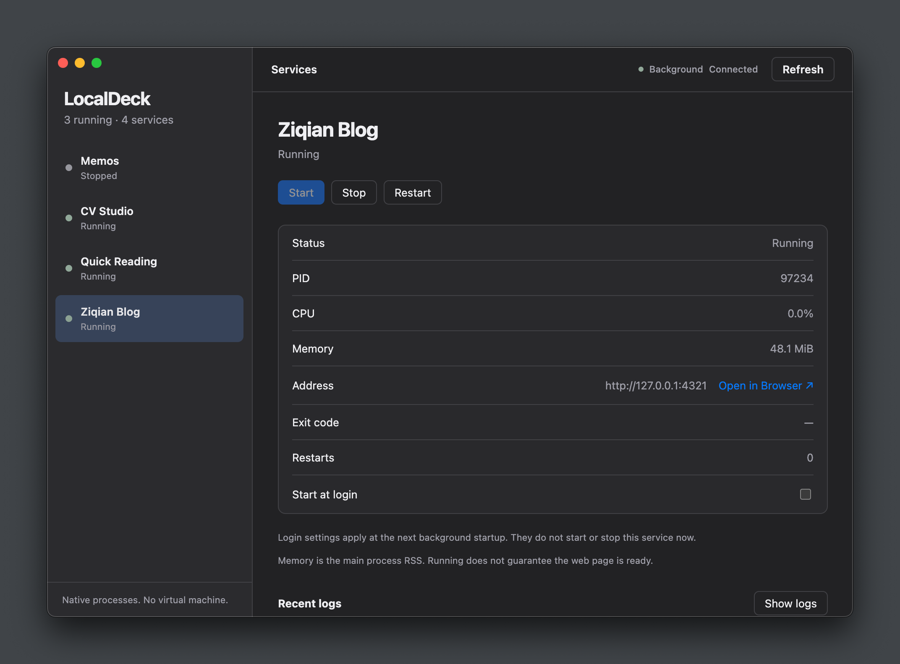
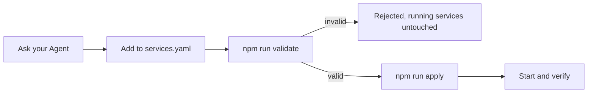

# Wick

A small macOS console for native local services. Electron supplies the window; Process Compose runs the services. No Docker or Linux VM.



## Open the app

The Apple Silicon build is `dist/Wick-darwin-arm64/Wick.app`. You can open it directly, or copy it to Applications and open that copy. Open the app from its permanent location so the login bootstrap can find it later.

Prerequisite:

```bash
brew install f1bonacc1/tap/process-compose
```

First normal launch creates the service configuration and a user-level login background job. The default configuration has no services. **No existing processes are imported or stopped.** Login autostart only starts services whose individual switch is enabled.

## Daily use

- Select a service to see status, PID, CPU, main-process RSS, address and exit details.
- Use **Start**, **Stop**, **Restart** or **Show logs**. **Open in Browser ↗** is next to the service Address.
- The top indicator reports the background connection: Connected, Connecting or Unavailable. Configuration errors do not mean the background is disconnected. Use **Reconnect** when unavailable.
- **Start at login** affects the next background startup, not the current service state.
- Closing the window quits the console. Services continue running.
- **Refresh** rereads status; when the background is unavailable this button becomes **Reconnect**, which tries to reconnect/start it if needed.

Ask your Agent to read the [Wick Skill](skills/wick/SKILL.md) and register an installed service. You do not need to remember startup commands. The one editable file is `~/Library/Application Support/Wick/services.yaml`. Generated runtime files are not configuration sources.

## Agent Skill

The Chinese [Wick Skill](skills/wick/SKILL.md) covers service registration, configuration and commands, existing-process takeover and data handling, daily operations, login autostart, recovery and troubleshooting.

```bash
npm run skill:install
```

This links the repository's Skill into `~/.agents/skills/wick`, preserving an existing unrelated Skill. Keep the repository at its installed location. Pi discovers this shared directory; run `/reload` in an existing session or start a new session, then use `/skill:wick` when an explicit invocation is useful. Other Agents that support the shared Agent Skills directory can discover it too.

### Registering a service



`services.yaml` is the only configuration source; `runtime.yaml` is generated. Always validate before applying, and never run `process-compose project update -f services.yaml` directly.

## Develop and verify

```bash
npm install
npm start
npm run check
npm test
npm run test:e2e
npm run build
npm run measure
```

The optional measurement command requires the macOS Command Line Tools and a completed build. It launches only isolated test services, captures the complete Electron process tree and macOS physical-footprint counters, saves screenshots/results, then stops the test processes.

The application icon source is the transparent 1024×1024 PNG in `assets/icon.png`. Each build uses macOS `sips` and `iconutil` to generate all required sizes and package `assets/icon.icns`. To update the artwork, replace the PNG and rebuild.

The build produces a local unsigned Apple Silicon app. It is not a signed public release. `npm run build` replaces its own generated output only.

Set `WICK_HOME` to an absolute temporary directory for isolated testing. This also prevents the GUI from installing the normal login job. Integration tests use real Process Compose; login tests use distinct launchd labels and remove those jobs afterward. Run tests sequentially.

## Background and troubleshooting

- User job: `dev.wick.manager`, defined under your user LaunchAgents directory.
- Private control socket: `control.sock` in the Wick data directory.
- Recent logs: last 200 lines, capped at 128 KiB in the console.
- Service log files: native rotation, by default 1 MiB plus 2 backups.
- Bootstrap diagnostics: `startup.log`, replaced on background startup.
- Default crash recovery: 3 automatic retries, 2-second backoff. The count accumulates for that service's current registration; it is not a sliding time-window counter. After exhaustion, fix the cause and use the console's Start or `npm run recover -- <service>`.
- Process Compose does not reliably identify whether signal exit `-1` was a manual stop. The console shows the exit code and an explanation rather than inventing the cause.
- If an operation was interrupted and left `operation.lock`, check that no Wick configuration/start operation is running, then move that generated lock to Trash and retry.
- Applying invalid configuration does not stop existing services. Fix the configuration, apply it again, then Refresh.

Disabling every service's login switch leaves the lightweight manager available but starts no service. To stop the background manager for the current session, quit the console and use Process Compose's `down` command with the Wick socket. To disable the login background entirely, unload `dev.wick.manager` and move its plist to Trash; opening the app normally installs it again.

## Validation limits

Real launchd bootstrap and supervision were exercised in the existing login session, including the packaged app's Node bootstrap. **Actual logout/re-login has not been tested**, because it would interrupt the user's session. No Memos data migration or OrbStack/Docker cleanup was performed.

Resource observations, screenshots and test results are recorded with the MVP work under `.scratch`. RSS sums contain shared mappings; do not treat them as unique physical RAM. The current implementation has no guaranteed 150 MB GUI limit.
